# Scan Insights for Nessus

Scan Insights for Nessus is a simple tool for displaying data from a Nessus scan file (`.nessus`). It is ideal after an internal (or external) Nessus scan was conducted to display the found vulnerabilities. It offers many filtering and search options, and makes copying the data easier than Nessus does.

The application also focuses on privacy. Scan contents stay in memory and are never written to disk, unless you export them. The app only stores its settings, your projects, and your list of recently opened files in the app data folder (`%AppData%\com.scaninsights.nessus` on Windows, `~/.local/share/com.scaninsights.nessus` on Linux). Projects and recent files contain the full paths and names of your scan files. On Linux, new files the app creates (including exports) can only be read by your user. The app makes no network connections of its own (it only opens your browser when you click a reference or CVE link).

The app is built with Tauri (Rust), React, TypeScript and Tailwind CSS.

For a detailed list of changes, see the [Changelog](./Changelog.md).

## Installation

Download the file for your system from the [Releases](../../releases) page.

| System | File | Notes |
|---|---|---|
| Windows | `-setup.exe` or `.msi` | NSIS or MSI installer |
| Windows | `_portable.exe` | Runs without installing |
| Ubuntu, Debian | `.deb` | Installs its dependencies automatically |
| Fedora | `.rpm` | Installs its dependencies automatically |
| Other Linux | `.AppImage` | Runs without installing, after `chmod +x` |

**Windows:** the app needs the WebView2 Runtime, which is pre-installed on Windows 10 21H2+ and Windows 11.

**Linux:** the packages need Ubuntu 24.04, Debian 13, Fedora 40 or newer. If the window stays blank, which is a known WebKitGTK problem on some graphics setups, start the app with `WEBKIT_DISABLE_DMABUF_RENDERER=1 scan-insights-for-nessus`.

## Main Features

The app has the below main features:
- dark/light mode
- filtering options everywhere (by host, by vulnerability, etc.)
- multiple copy options (copy single or multiple affected hosts with or without ports etc.)
- opening several files at once, with progress per file
- general dashboard overview
- view details about specific vulnerabilities, hosts or services
- inspect the topology and possible attack paths (this is limited)
- compare two scan files
- inspect how vulnerability trends evolved with time
- create projects (e.g. quarterly scans)
- export to `.xlsx`, `.csv` formats, or merge multiple files into a single `.nessus` file

## Sidebar menu
- [Dashboard](#dashboard)
- [Vulnerabilities](#vulnerabilities)
- [Hosts](#hosts)
- [Services](#services)
- [Topology](#topology)
- [Compare](#compare)
- [Trends](#trends)
- [Projects](#projects)
- [Export](#export)

> [!NOTE]
> **Info findings:** Info findings are mostly noise, so they start hidden on every page. You can use the `Show Info findings` option to display them. Hosts and services with nothing but Info findings stay listed, because they are still machines and open ports in the scan. `Export` is the exception: it has its own severity selection, which includes Info findings unless you turn it off.

## Dashboard

The app gives the ability to open one or multiple files at once. After opening a file the `Dashboard` menu gives an overview of the vulnerabilities. A file with no scanned hosts, such as one holding only a scan policy, isn't loaded.

The top of the view displays a severity strip, where the count of the vulnerabilities of all loaded files is displayed. Below it are the "Top vulnerabilities", which are sorted by criticality and the number of hosts they affect. It also shows if a vulnerability has a known exploit, its CVSS score and how many hosts it was found on. In the middle part the "Top vulnerable hosts" and "Findings by family" are shown. The bottom part displays all currently loaded scan files.

Top and middle part of the Dashboard:  

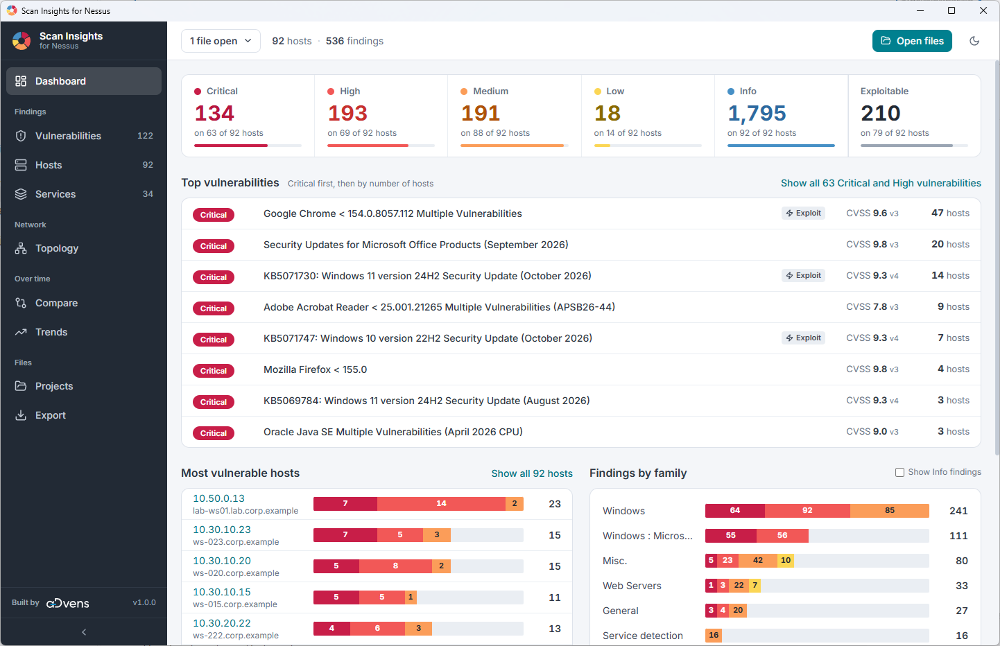

Bottom part of the Dashboard:  

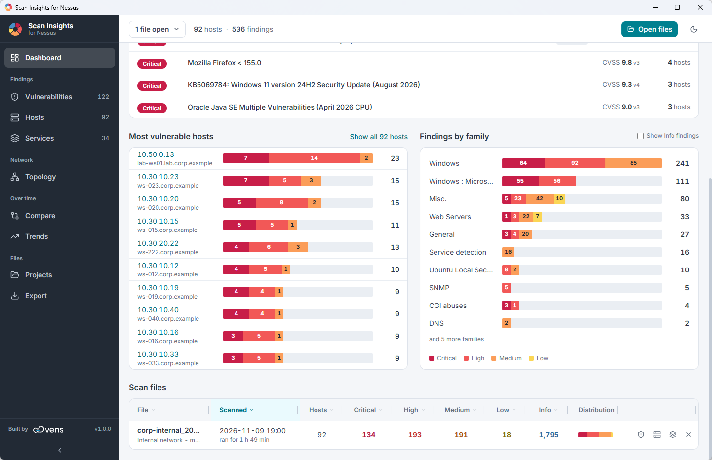

Clicking on the name of a scan file reveals information about the scan configuration (name, date, duration, configured targets, scanned hosts, etc.).  

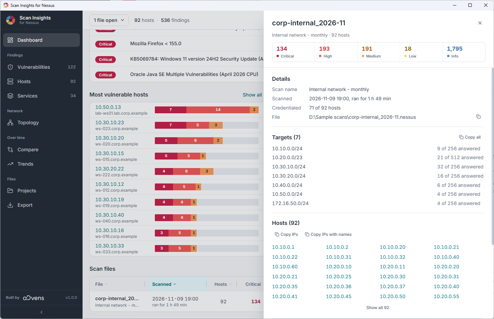

## Vulnerabilities

The `Vulnerabilities` view offers a more detailed overview of the vulnerabilities. Multiple filtering options are available (by severity, if an exploit is available, plugin family). You can sort them by clicking on the appropriate column (Severity, Name, Family, CVSS etc.). Additional columns can be displayed using the column picker.

The severity comes from the scan file, and the table shows the CVSS version score (e.g. `9.3 v2`). Clicking a vulnerability shows all its scores.

With several files loaded, a finding rated differently between them shows its worst rating and that rating's scores, and its details say which file rated it how. Filtering to one file shows that file's own rating.

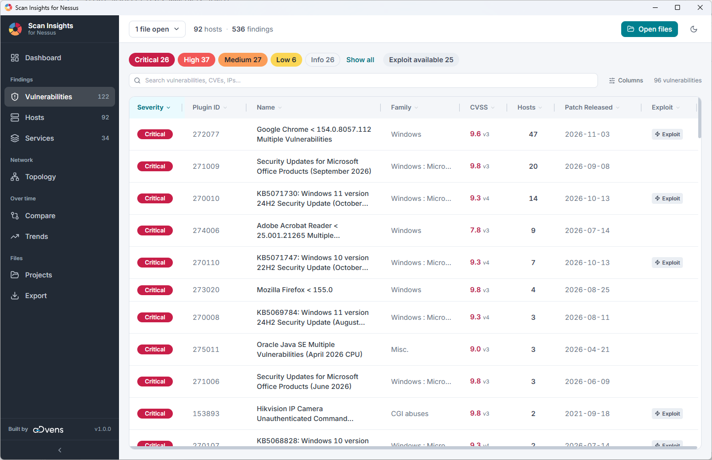

Clicking on a vulnerability gives an overview on which hosts the vulnerability is present, and a short description of it.

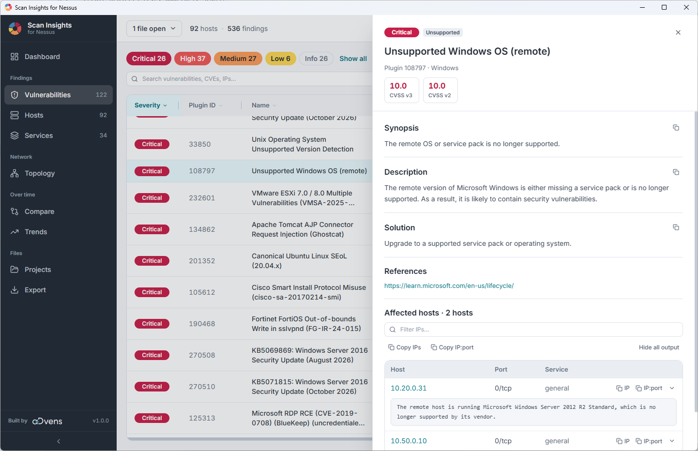

## Hosts

The `Hosts` menu shows how many vulnerabilities each host has. Filtering options by severity are present here as well. Additional columns can be displayed using the column picker. A copy button is also present, which copies the hostnames, IP addresses or the displayed table which can be directly pasted into Excel.

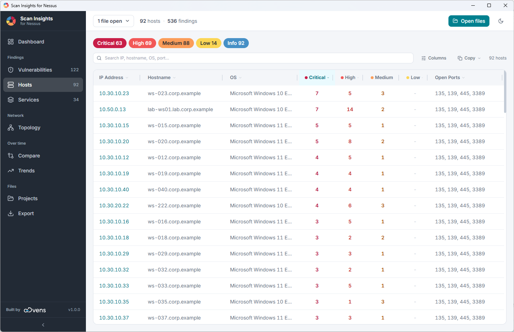

Clicking a host shows information about that system (OS, Domain, MAC Address, open TCP/UDP ports, etc.) and what other vulnerabilities are present on that system.  

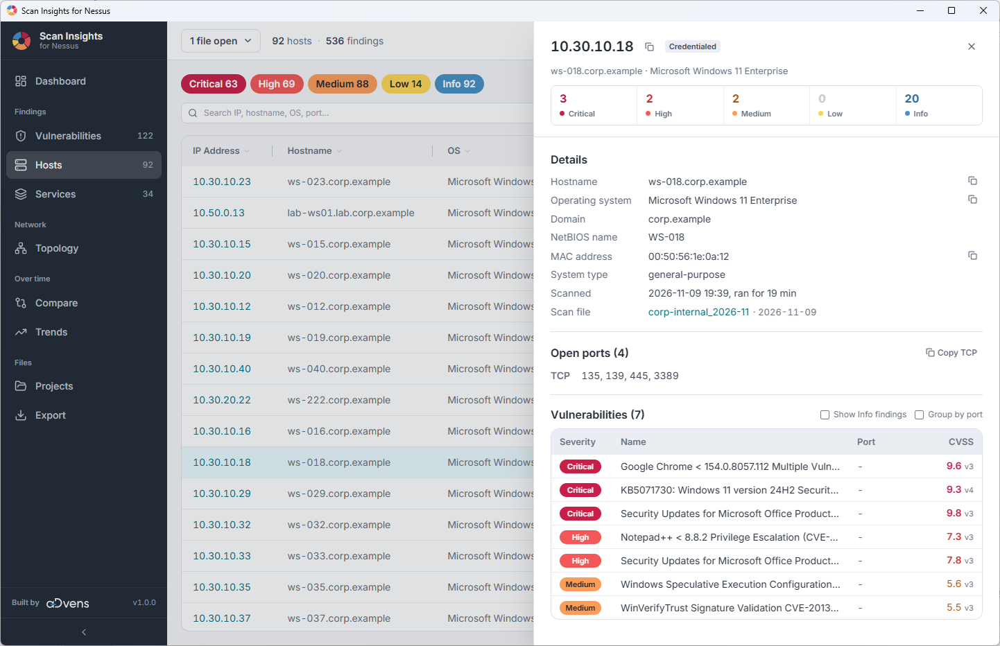

## Services

The `Services` menu lists every port and protocol that has at least one finding, with how many hosts have it and how severe its findings are. A port counts as a service only because Nessus reported something on it, so a port with no findings doesn't appear. This view also offers filtering by severity, and additionally by TCP/UDP ports. Additional columns can be displayed using the column picker.  

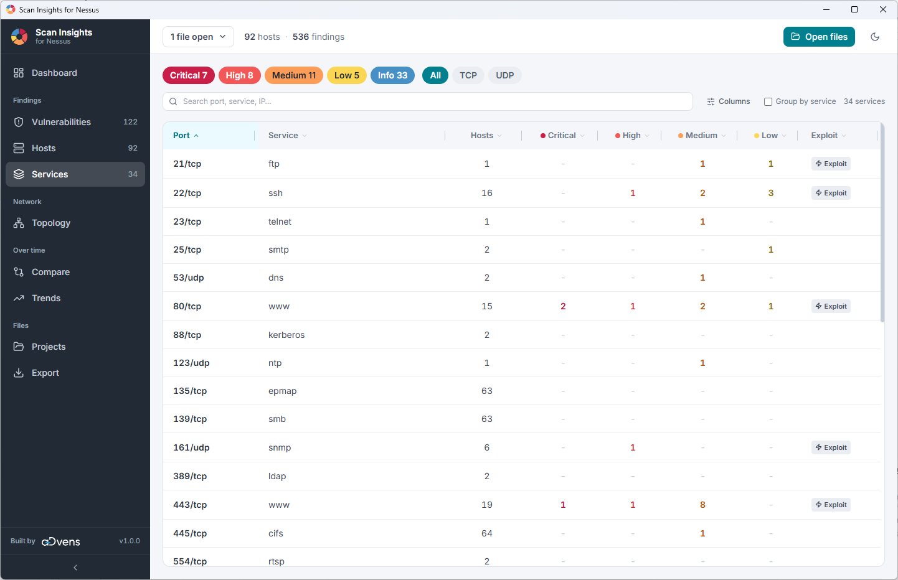

It is also possible to group ports by services. This means that for example if Nessus identified that a `www` service is running on port 80,8080,8081 then these ports will be grouped.  

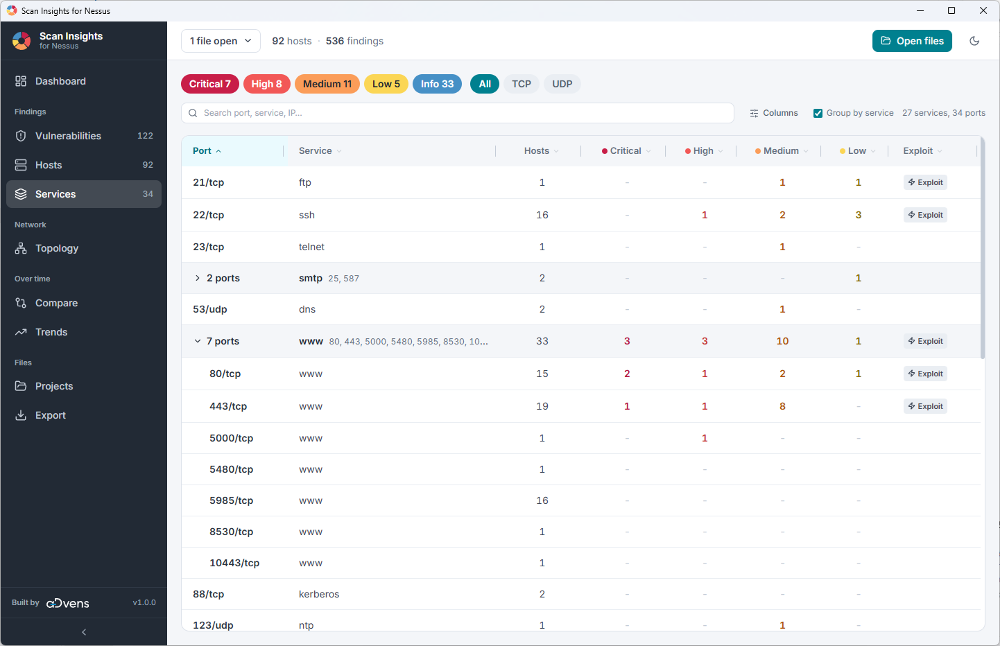

Clicking one service shows those hosts and findings.  

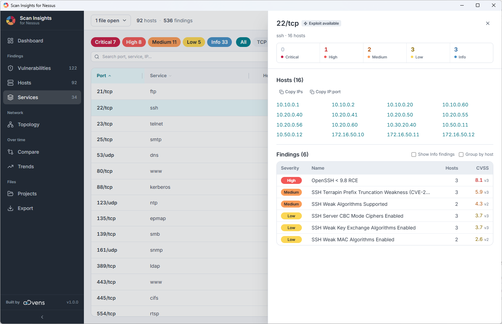

## Topology

The `Topology` menu draws networks, plus the machines that connect them. Each network is a `/24` unless the scan reveals its real size, and machines are coloured by their worst finding. When more than 8 networks sit behind the same router, they are folded into a larger block (a `/16`, or a range from a routing table), which opens on click. Only machines that connect networks are drawn, and clicking one shows its details. Clicking a network shows its attack path.

The graph is inferred from the scan data, so it is not a map of the real network. Solid links mean confirmed path, dashed mean likely or possible path, and the teal line shows the possible attack path. Hosts are matched by IP address alone, so only load files from the same network environment.

The view also lists machines that are present on multiple networks (e.g. multiple network cards which get IP addresses from different network segments). Networks that were never scanned are marked separately, and so is a machine's address on such a network.

The view also shows a possible attack path. Pick a network in the `Attack path to` list to see the steps from the scanner to it, which machines lead there, and their findings.

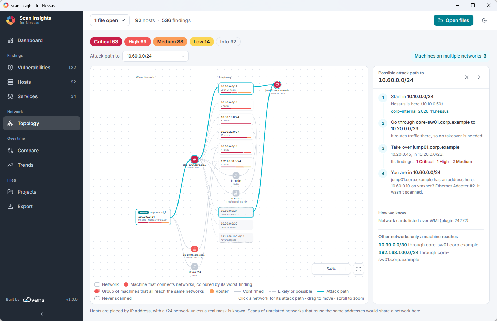

## Compare

In the `Compare` menu two scan files can be selected for comparison. This is ideal if you do scans in intervals (e.g. every month or every 3 months etc.). Selecting two files will compare them and inspect which vulnerabilities are resolved, or which vulnerabilities are new, or which persisted. Findings are matched by plugin, host, port and protocol.

A finding only counts as resolved if its host was scanned again without losing credentials. Otherwise it is listed as `Not verified`, because the second scan cannot confirm a fix. A different scan policy can still hide a finding, so compare scans that used the same policy.

Comparing scan files can be done either by vulnerabilities or by hosts. If files are compared by vulnerabilities then a vulnerability is inspected on how many hosts it was present in the old and in the new file.

**Change types:**
  - **New:** Vulnerability is present only in the new (B) file.
  - **Fixed:** Vulnerability is gone from every host that had it, and the new scan confirms it on all of them.
  - **Partly fixed:** Vulnerability is confirmed fixed on some hosts, but others still have it.
  - **Changed:** Vulnerability is confirmed fixed on some hosts, but new on others.
  - **Increased:** Vulnerability is new on some hosts, and none of the old ones is confirmed fixed.
  - **Not verified:** Vulnerability is gone from some or all hosts, but the new scan can't confirm a fix, because those hosts were not rescanned or the login failed.
  - **Unchanged:** Vulnerability is present on the same hosts in both files.

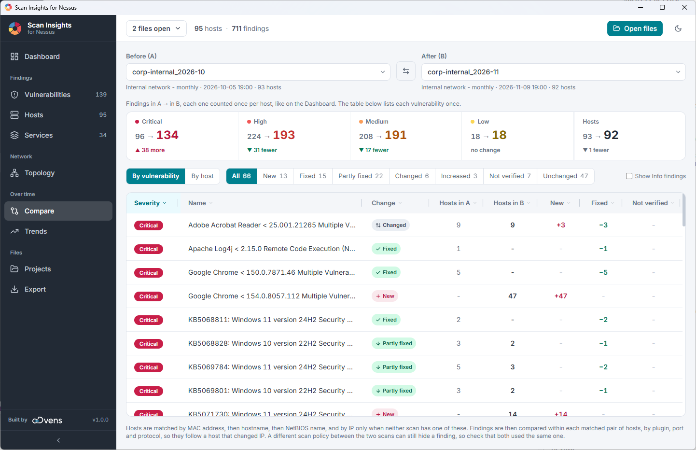

If files are compared by hosts then a host is inspected how many vulnerabilities it had in the old and in the new file.

**Change types:**
  - **Worsened:** The host has more findings at the worst severity that changed.
  - **Improved:** The host has less findings at the worst severity that changed.
  - **New hosts:** Host is only present in the new scan file, not in the old one.
  - **Not rescanned:** Host is present only in the old scan file, but not in the new one.
  - **Different machine:** A different machine got this IP address in the new file.
  - **No change:** The vulnerabilities did not change between scans.

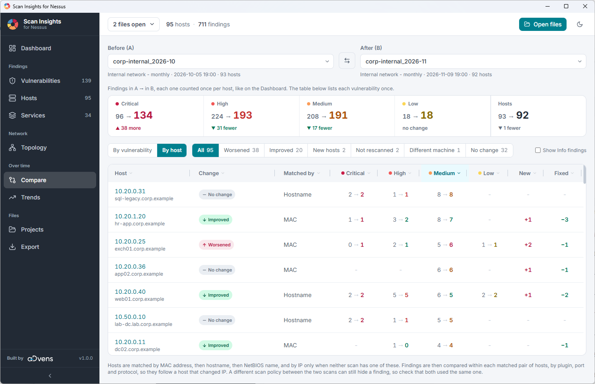

## Trends

The `Trends` menu displays a trend, how the vulnerabilities have changed between scans. The menu tries to find scans that target the same hosts/ranges. It analyzes the count of the vulnerabilities and displays them as either lines or bars on a chart.  

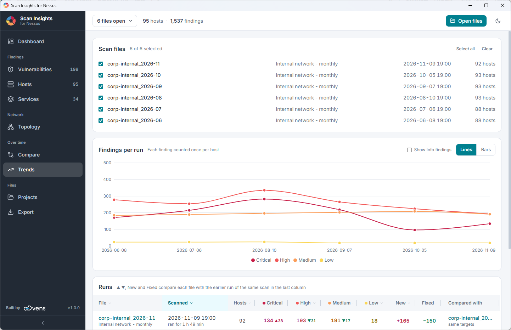

The bottom part of the window lists all selected files, and if their targets match, it compares the scan to the previous scan and shows how the vulnerabilities have changed.  

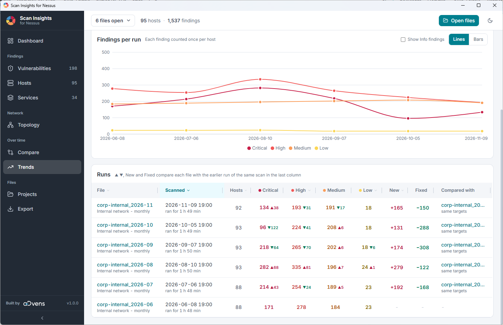

## Projects

Under the `Projects` menu you can create a "Project". This is basically a group where you can assign multiple files. This is ideal if you want to work with multiple scan files (e.g. analyze the trend of vulnerabilities during quarterly scans). This makes it easier to load the selected files. Loading a project means that all the currently loaded files are unloaded.

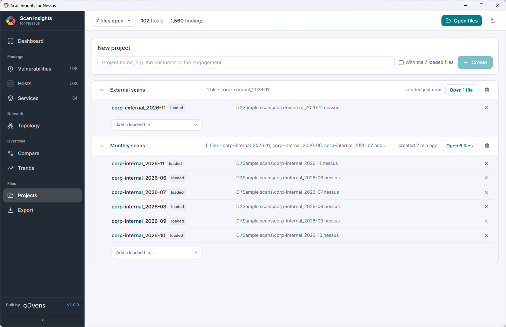

## Export

The `Export` menu gives multiple options to export vulnerabilities. You can select to export all or specific files, and which severities to include. The resulting file can be a `.xlsx` or `.csv` according to your needs. It is also possible to export into a `.nessus` file, but in this case if multiple files are selected, the files will be merged. When exporting several files, a host with the same IP becomes one entry and a finding seen in more than one file is kept once, with its worst rating. In a `.csv`, cells that a spreadsheet would run as a formula start with an added `'`.

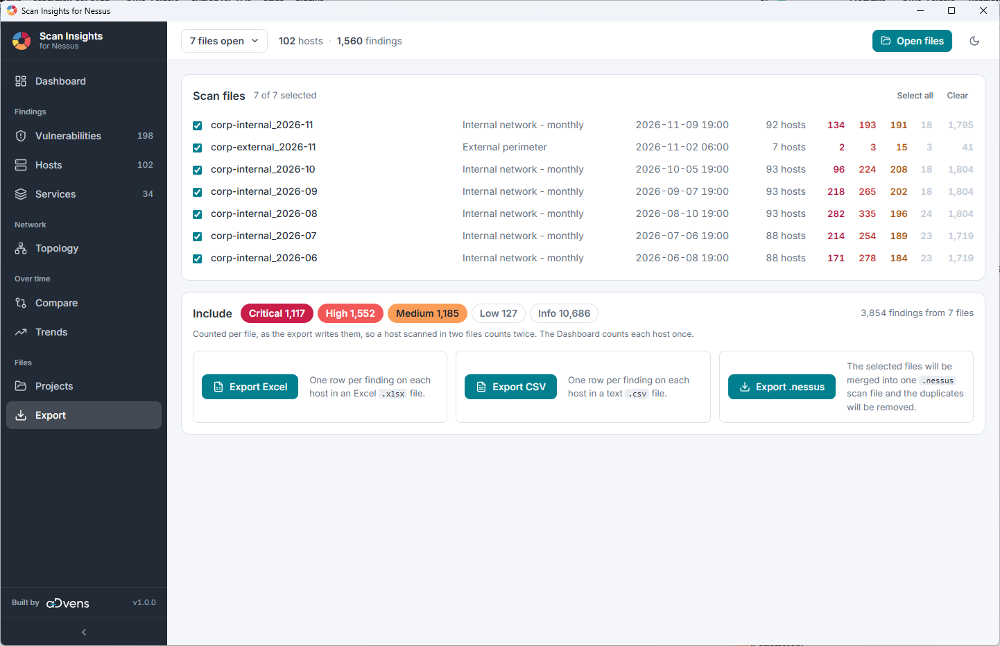

## Development

If you'd like to help in development install the prerequisites then clone the repository and run the below commands.

**Prerequisites**
- [Rust](https://rustup.rs/) (current stable)
- [Node.js](https://nodejs.org/) (20+)
- Windows: WebView2 Runtime (pre-installed on Windows 10 21H2+ and Windows 11)
- Linux: the libraries Tauri compiles against. On Ubuntu or Debian:
  ```bash
  sudo apt install build-essential curl wget file pkg-config libwebkit2gtk-4.1-dev \
    libxdo-dev libssl-dev libayatana-appindicator3-dev librsvg2-dev
  ```

**Start developing**
```bash
# install dependencies
npm i
# run in development mode
npm run tauri dev
```

**Checks** (CI runs these on Windows and Ubuntu on every push to `main` and every pull request)
```bash
npm run lint
npm test
npm run build
cd src-tauri
cargo clippy --all-targets -- -D warnings
cargo test
```

The npm `@tauri-apps/*` packages and the Rust `tauri*` crates must stay on the same minor version, so upgrade them together.

**App logo:** replace `src-tauri/icons/icon.svg`, run `npm run icons`, then rebuild. This updates the exe, the window and the sidebar, which all use the PNG and ICO files generated from it. A square SVG with a transparent background works best.

### Building

A build only produces files for the system it runs on, so Linux packages can't be built on Windows or the other way around.

#### App only (simplest)

```bash
npm run tauri build -- --no-bundle
```

The app will be located at `src-tauri/target/release/scan-insights-for-nessus.exe` on Windows and `src-tauri/target/release/scan-insights-for-nessus` on Linux. The Linux file only runs where WebKitGTK is installed. Use this command rather than plain `cargo build --release`, which skips the frontend build and produces an app that looks for the development server.

#### Installers

```bash
npm run tauri build
```

This produces the installers in `src-tauri/target/release/bundle/`: MSI and NSIS on Windows, and `.deb`, `.rpm` and AppImage on Linux. On Ubuntu or Debian, the AppImage also needs the `file`, `xdg-utils` and `libfuse2t64` packages.

PRs are welcome :)
